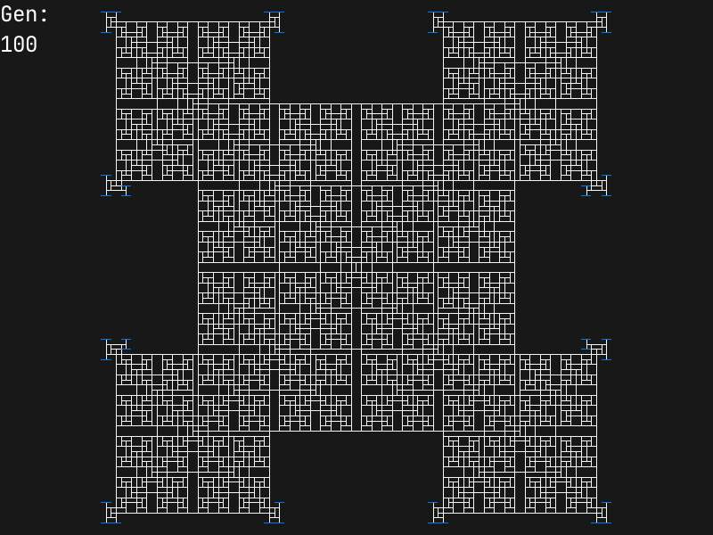

# project-template-c_raylib_utils

[](https://github.com/semantic-release/semantic-release)

Fractal like toothpicks pattern.
Inspiration from [Terrific Toothpick Patterns - Numberphile](https://www.youtube.com/watch?v=_UtCli1SgjI).



# Build and run

Simply do:

```console
make run
```
